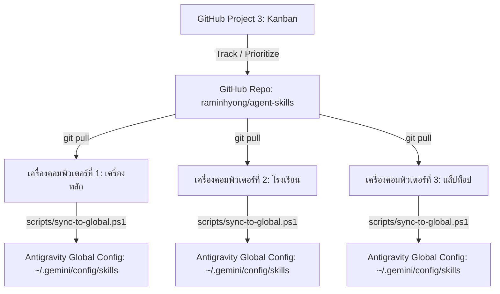

# Antigravity Central Skill Hub & Multi-Machine Sync

ศูนย์กลางบริหารจัดการ บันทึกประวัติ และซิงก์สกิลทั้งหมดของ **Google Antigravity** ข้ามเครื่อง (Home PC / School PC / Laptop) รองรับการพัฒนาและนำเข้าสกิลใหม่ในทุก ๆ วัน พร้อมสารบบคำสั่งลัด (`/`) และการคัดแยกสกิลที่ไม่ใช้งานออกเพื่อลดความสับสนของ Agent

---

## 1. สถาปัตยกรรมระบบซิงก์ข้ามเครื่อง (Multi-Machine Sync Architecture)



```text
+-------------------------------------+--------------------------------------+---------------------------+
| CENTRAL AGENT SKILLS ARCHITECTURE                                                                      |
+-------------------------------------+--------------------------------------+---------------------------+
| [ หมวดการสอนภาษาไทย / งานโรงเรียน ] | [ หมวดพัฒนาเว็บแอป / สื่อการสอน ]    | [ หมวดวิจัย / ถอดรหัส ]   |
| - thai-doc (/thai-doc, /doc)        | - build-learning-webapp (/app-build) | - rea (/rea)              |
| - thai-subapp-blueprint (/subapp)   | - debug-existing-webapp (/app-debug) | - agent-reach (/reach)    |
| - picseek (/picseek)                | - visual-dev-loop (/visual-dev)      | - typesafe-ai (/typesafe) |
| - human-like-learner (/learner)     | - arrange-card-deck-sheets (/cards)  |                           |
| - thai-project-proposal (/project)  | - prepare-piles-print-cards (/piles) |                           |
| - thai-official-memo (/memo)        | - align-points-to-image-path         |                           |
| - thai-exam-format (/exam)          | - thai-web-fonts (/fonts)            |                           |
+-------------------------------------+--------------------------------------+---------------------------+
| [ สกิลที่ถูกถอดถอนและเก็บเข้า Archive (ลดความสับสน Agent) ]                                            |
| - 27 Google Cloud BigQuery / Airflow / Dataflow / Composer Skills (เก็บไว้ที่ archive/)                |
+-------------------------------------+--------------------------------------+---------------------------+
```

---

## 2. ตารางจัดหมวดหมู่สกิลในเครื่องตามการใช้งานและความถี่

| ลำดับ | สกิล (Skill Name) | คำสั่งลัด (Slash Command) | ลักษณะงาน / บทบาท | ความถี่ในการใช้งาน | สถานะ |
| :---: | :--- | :--- | :--- | :---: | :---: |
| 1 | **`thai-doc`** | `/thai-doc`, `/doc` | เอกสารราชการไทย, TH Sarabun New, 0pt spacing, ตัดคำ `\u200b`, ปิดหยักแดง `noProof` | รายวัน (Daily) | 🟢 Active Core |
| 2 | **`picseek`** | `/picseek` | สแกนและค้นหารูปภาพกิจกรรม/หลักฐานเจาะจงโฟลเดอร์ตามตัวชี้วัด | รายวัน (Daily) | 🟢 Active Core |
| 3 | **`rea`** | `/rea` | ถอดรหัสโปรแกรม แกะโค้ด สถาปัตยกรรม Clean-room Reimplementation | รายวัน (Daily) | 🟢 Active Core |
| 4 | **`agent-reach`** | `/agent-reach`, `/reach` | สืบค้น วิจัย และวิเคราะห์ข้อมูลเชิงลึกจาก 16 แพลตฟอร์มโซเชียล/วิชาการ | รายวัน (Daily) | 🟢 Active Core |
| 5 | **`human-like-learner`** | `/learner` | อบรมออนไลน์และทำข้อสอบอัตโนมัติผ่าน UI เลียนแบบมนุษย์ 100% | สูง (High) | 🟢 Active Core |
| 6 | **`visual-dev-loop`** | `/visual-dev`, `/preview` | รัน dev server, ตรวจหน้าจอด้วย browser subagent และบันทึก snapshot หลายขนาด | สูง (High) | 🟢 Active Core |
| 7 | **`thai-subapp-blueprint`** | `/subapp` | โครงสร้างและ Blueprint Micro-Frontend ของ Thai PW Hub | สูง (High) | 🟢 Active Core |
| 8 | **`build-learning-webapp`** | `/app-build` | ออกแบบและสร้างเว็บแอปห้องเรียน เกมการศึกษา | สูง (High) | 🟢 Active Core |
| 9 | **`debug-existing-webapp`** | `/app-debug` | วินิจฉัยและแก้บั๊กเว็บแอปเดิมโดยไม่กระทบโค้ดส่วนอื่น | สูง (High) | 🟢 Active Core |
| 10 | **`typesafe-ai`** | `/typesafe` | ตรรกะการตัดสินใจและเลือกเครื่องมือแบบ System One | สูง (High) | 🟢 Active Core |
| 11 | **`arrange-card-deck-sheets`**| `/card-deck`, `/cards` | จัดวางการ์ดเกมลงแผ่นพิมพ์ A4 พร้อมเส้นประสำหรับตัด | ปานกลาง (Medium) | 🟢 Active Core |
| 12 | **`prepare-piles-print-cards`**| `/piles` | แยกเฟรมการ์ดตัวละคร Piles ปรับขนาด พร้อมติดป้ายชื่อไทย | ปานกลาง (Medium) | 🟢 Active Core |
| 13 | **`align-points-to-image-path`**| - | มาร์กและคำนวณพิกัดจุดเดินบนภาพแผนที่/บอร์ดเกม | ปานกลาง (Medium) | 🟢 Active Core |
| 14 | **`managing-python-dependencies`**| - | จัดการ virtualenv และ dependencies ของ Python | ปานกลาง (Medium) | 🟢 Active Utility |
| 15 | **`accidental-data-loss-prevention`**| - | เฝ้าระวังและป้องกันการลบข้อมูลสำคัญหรือไฟล์สำคัญ | เฝ้าระวัง (Guard) | 🟢 Active Guard |
| 16 | **`skill-repair`** | - | ซ่อมแซม manifest ของสกิลที่ติดตั้งไม่สมบูรณ์ | ยามจำเป็น | 🟢 Active Utility |
| 17 | **`thai-project-proposal`** | `/project` | เขียน/แก้/ตรวจโครงการสถานศึกษาให้ตรงแบบฟอร์มโรงเรียนและเอกสารจัดทำแผน | สูง (High) | 🟢 Active Core |
| 18 | **`thai-official-memo`** | `/memo` | สร้างบันทึกข้อความราชการ (ไปราชการ/รายงานผล/ส่งข้อสอบ/ชี้แจง/สอนแทน) ครบทุกฟิลด์ + บล็อกความเห็นผู้อำนวยการ | สูง (High) | 🟢 Active Core |
| 19 | **`thai-smart-form-apps`** | `/form-app` | แอปกรอกแบบฟอร์มราชการ (smart-form-filler): กรอกน้อยที่สุด, ต่อฐานข้อมูลนักเรียน/ครู/วิชา/ผู้บริหาร, dropdown ปี-ภาค-วันที่ (ปฏิทินไทย), พรีวิว A4 แบ่งหน้าจริง, สร้าง .docx ฝั่งเบราว์เซอร์ | สูง (High) | 🟢 Active Core |
| 19 | **`thai-exam-format`** | `/exam` | จัดฟอร์แมตเอกสารข้อสอบ DOCX (ปก ตารางมาตรฐาน ตัวเลือก keep-together) ตามมาตรฐานโรงเรียน | สูง (High) | 🟢 Active Core |
| 21 | **`thai-web-fonts`** | `/fonts` | ดึง/self-host/ตรวจฟอนต์ไทย 11 ตระกูล (Google Fonts woff2, LINE Seed, TH Sarabun New) + สร้าง @font-face + specimen ให้เลือกคู่ฟอนต์ | สูง (High) | 🟢 Active Core |
| 22-48 | **Google Cloud Data (27 รายการ)** | - | BigQuery, Airflow, Composer, Dataflow, Dataproc | ไม่ได้ใช้ในงานหลัก | 📦 Archived |

> **นโยบายการ mirror (สำคัญ)**: hub นี้เก็บ **เฉพาะสกิลที่เราเป็นเจ้าของ/ดูแลเอง** — สกิล `builtin` ที่ Hermes Agent แถมมา (docx, pdf, xlsx, github, notion, google-workspace, apple-*, computer-use ฯลฯ) **ไม่ถูกคัดลอกเข้า repo** ให้อ้างอิง upstream แทน เพื่อไม่ให้ repo บวมและไม่ให้ `sync-to-global.ps1` ดันสกิลเต็มชุดเข้า Antigravity · สกิล GCP ที่เลิกใช้แล้วอยู่ใน `archive/` (ไม่ load เข้า agent)

---

## 3. สคริปต์สำหรับการซิงก์ข้ามเครื่อง

| สคริปต์ | คำสั่ง | ประโยชน์ |
| :--- | :--- | :--- |
| **ซิงก์เข้าเครื่อง** | `powershell -File scripts/sync-to-global.ps1` | นำสกิลใน repo นี้เข้าสู่ `~/.gemini/config/skills` บนเครื่องปัจจุบัน |
| **คลีนสกิลที่ไม่ใช้** | `powershell -File scripts/clean-unused-from-global.ps1` | ถอดถอนสกิล GCP 27 ตัวออกจากเครื่องหลัก เพื่อประหยัด Token และไม่ให้ Agent สับสน |
| **ซิงก์เข้าสู่ Hermes Agent** | `powershell -File scripts/sync-to-hermes.ps1` | คัดลอกสกิลชุดเอกสารไทย (`thai-project-proposal`, `thai-official-memo`, `thai-exam-format`) ไปไว้ที่ `%LOCALAPPDATA%\hermes\skills\productivity` ให้ Pancake ใช้เวอร์ชันล่าสุด |

---

## 4. บันทึกงานบน GitHub (Repository & Project 3)

- **Repository**: [https://github.com/raminhyong/agent-skills](https://github.com/raminhyong/agent-skills)
- **GitHub Project 3**: [https://github.com/users/raminhyong/projects/3/settings](https://github.com/users/raminhyong/projects/3/settings)
- **คู่มือเชื่อมโยง Project 3**: ดูใน [project-board/PROJECT_3_SETUP.md](file:///d:/MEGA/AGENT%20SKILLS/project-board/PROJECT_3_SETUP.md)
---

## 5. ชุดสกิลงานสารบรรณ–โครงการ–ข้อสอบ (Thai School Documents Suite)

สามสกิลนี้ต่อยอดจาก `thai-doc` (มาตรฐานกลาง) แต่แยกตาม **ชนิดเอกสาร** — โหลดผิดตัวจะได้ค่าพิกัดผิดทันที

| งาน | สกิล | คำสั่งลัด | เอกสารอ้างอิงในสกิล |
| :--- | :--- | :--- | :--- |
| เขียน/แก้/ตรวจโครงการสถานศึกษา | `thai-project-proposal` | `/project` | `references/plan-2569-source.md` · `references/plan-2569-full.pdf` · `examples/โครงการ01_ตัวอย่าง.docx` |
| บันทึกข้อความราชการ | `thai-official-memo` | `/memo` | `references/exam-submission-memo-spec.md` · `examples/` (แบบเปล่า/การสอนแทน/ส่งข้อสอบ) |
| แอปกรอกฟอร์ม + พรีวิว A4 | `thai-smart-form-apps` | `/form-app` | กติกากรอกน้อยที่สุด · ฐานข้อมูลโรงเรียน · pagination · DOCX builder |
| จัดฟอร์แมตข้อสอบ DOCX | `thai-exam-format` | `/exam` | `references/format-spec-full.md` · `references/master-rules.md` · `examples/Job03.json` + `Job03_Formatted.docx` |

**ค่าที่ต่างกันระหว่างสามสกิล (จุดที่พลาดบ่อย)**

| รายการ | โครงการ | บันทึกข้อความ | ข้อสอบ |
| :--- | :--- | :--- | :--- |
| ระยะขอบ | 1.5 / 1.0 / 1.5 / 1.0 นิ้ว | บน 0.79" ล่าง 0.50" ซ้าย 1.00" ขวา 0.79" | บน-ล่าง 0.5" ซ้าย 0.7" ขวา 0.8" |
| `noProof` (ปิดหยักแดง) | **ห้ามใช้** (ต้องเห็นคำที่อาจผิด) | ใช้ | ใช้ |
| Zero-width space `\u200b` | ต้องมีทุกส่วน รวมนอกตาราง | ต้องมีทุก run | ต้องมี (ห้ามแทรกกลางสระ/วรรณยุกต์) |

สคริปต์ของทั้งสามสกิลรันด้วย `py -3.12` (มี `python-docx 1.2.0` / `pythainlp 5.3.7` / `pymupdf 1.28.2`) — Python 3.14 ที่ Hermes ใช้ไม่มี python-docx

---

## 6. ชุดเครื่องมือเบราว์เซอร์ตัวจริง (Live Browser Toolset)

เบราว์เซอร์ของ agent ทั่วไปรัน **headless** และใช้โปรไฟล์ชั่วคราว → ผู้ใช้มองไม่เห็น และต้องล็อกอินใหม่ทุก session
ชุดนี้แก้ด้วยการเปิด **Chrome ตัวจริง** (`--user-data-dir` ถาวร + `--remote-debugging-port`) แล้วเกาะด้วย Playwright ผ่าน CDP

| ไฟล์ | หน้าที่ |
| :--- | :--- |
| `tools/live-browser/live.sh` · `live.cmd` | เปิด Chrome มีหน้าต่างจริง + CDP + โปรไฟล์ถาวร |
| `tools/live-browser/pw.mjs` | CLI หลัก: `goto · shot · text · click · clickcss · fill · press · eval · download · fetchsave` |
| `tools/live-browser/seek.mjs` | กรอวิดีโอ JW Player ไปปลายคลิปด้วยการคลิกแถบเวลาจริง |
| `tools/live-browser/dl.mjs` | ดาวน์โหลดผ่าน UI ไปโฟลเดอร์ที่กำหนด (CDP download behavior) |
| `tools/live-browser/show-window.ps1` | ยกหน้าต่างที่ต้องการขึ้นหน้า (SetForegroundWindow) |
| `tools/live-browser/examples/answer.sh` | ตัวอย่างตอบข้อสอบออนไลน์แบบจังหวะคนจริง |
| `tools/live-browser/install.ps1` | ติดตั้งอัตโนมัติ (คัดลอกไป `%USERPROFILE%\tools\pw` + `npm i playwright` + หา Chrome) |
| `skills/live-browser/SKILL.md` | สกิลสำหรับ agent (ใช้เมื่อไหร่ · กติกาเหล็ก · กับดัก) |

```bash
cd tools/live-browser && npm i playwright
bash live.sh "https://example.com"     # ล็อกอินเองครั้งแรก → คุกกี้ค้างในโปรไฟล์
node pw.mjs status
```

**กติกา**: ห้ามพิมพ์รหัสผ่านแทนผู้ใช้ · ห้ามใช้ JS/API หลบขั้นตอนแพลตฟอร์ม · เช็ก `MainWindowTitle` ก่อนบอกว่า "เปิดหน้าให้แล้ว" · โปรไฟล์ `chrome-live/` ห้าม commit
