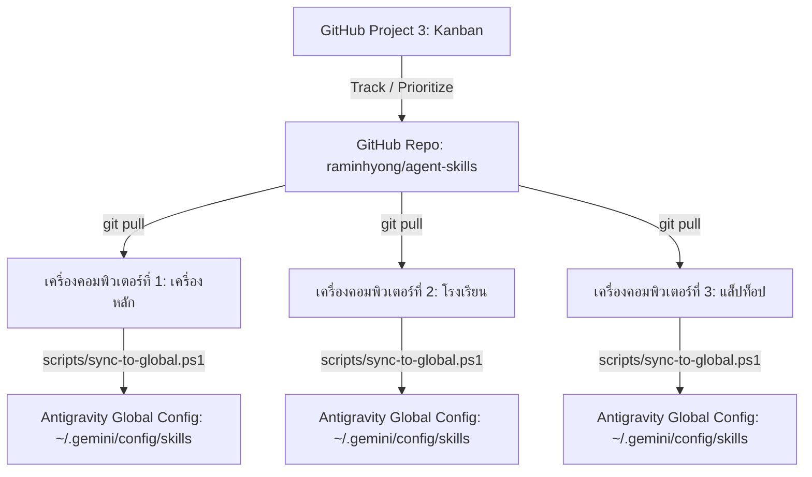

# Antigravity Central Skill Hub & Multi-Machine Sync

ศูนย์กลางบริหารจัดการ บันทึกประวัติ และซิงก์สกิลทั้งหมดของ **Google Antigravity** ข้ามเครื่อง (Home PC / School PC / Laptop) รองรับการพัฒนาและนำเข้าสกิลใหม่ในทุก ๆ วัน พร้อมสารบบคำสั่งลัด (`/`) และการคัดแยกสกิลที่ไม่ใช้งานออกเพื่อลดความสับสนของ Agent

---

## 1. สถาปัตยกรรมระบบซิงก์ข้ามเครื่อง (Multi-Machine Sync Architecture)



```text
+---------------------------------------------------------------------------------------------------+
|  CENTRAL AGENT SKILLS ARCHITECTURE                                                               |
+------------------------------------+------------------------------------+-------------------------+
|  [ หมวดการสอนภาษาไทย / งานโรงเรียน ]   |  [ หมวดพัฒนาเว็บแอป / สื่อการสอน ]   |  [ หมวดวิจัย / ถอดรหัส ]|
|  - thai-doc (/thai-doc, /doc)      |  - build-learning-webapp (/app-build)| - rea (/rea)            |
|  - thai-subapp-blueprint (/subapp) |  - debug-existing-webapp (/app-debug)| - agent-reach (/reach)  |
|  - picseek (/picseek)              |  - visual-dev-loop (/visual-dev)   | - typesafe-ai (/typesafe|
|  - human-like-learner (/learner)   |  - arrange-card-deck-sheets (/cards)|                         |
|                                    |  - prepare-piles-print-cards(/piles) |                         |
+------------------------------------+------------------------------------+-------------------------+
|  [ สกิลที่ถูกถอดถอนและเก็บเข้า Archive (ลดความสับสน Agent) ]                                      |
|  - 27 Google Cloud BigQuery / Airflow / Dataflow / Composer Skills (เก็บไว้ที่ archive/)          |
+---------------------------------------------------------------------------------------------------+
```

---

## 2. ตารางจัดหมวดหมู่สกิลในเครื่องตามการใช้งานและความถี่

| ลำดับ | สกิล (Skill Name) | คำสั่งลัด (Slash Command) | ลักษณะงาน / บทบาท | ความถี่ในการใช้งาน | สถานะ |
| :---: | :--- | :--- | :--- | :---: | :---: |
| 1 | **`thai-doc`** | `/thai-doc`, `/doc` | เอกสารราชการไทย, TH Sarabun New, 0pt spacing, ตัดคำ `\u200b`, ปิดหยักแดง `noProof` | รายวัน (Daily) | 🟢 Active Core |
| 2 | **`picseek`** | `/picseek` | สแกนและค้นหารูปภาพกิจกรรม/หลักฐานเจาะจงโฟลเดอร์ตามตัวชี้วัด | รายวัน (Daily) | 🟢 Active Core |
| 3 | **`rea`** | `/rea` | ถอดรหัสโปรแกรม แกะโค้ด สถาปัตยกรรม Clean-room Reimplementation | รายวัน (Daily) | 🟢 Active Core |
| 4 | **`agent-reach`** | `/agent-reach`, `/reach` | สืบค้น วิจัย และวิเคราะห์ข้อมูลเชิงลึกจาก 16 แพลตฟอร์มโซเชียล/วิชาการ | รายวัน (Daily) | 🟢 Active Core |
| 5 | **`human-like-learner`** | `/learner` | อบรมออนไลน์และทำข้อสอบอัตโนมัติผ่าน UI เลียนแบบมนุษย์ 100% | สูง (High) | 🟢 Active Core |
| 6 | **`visual-dev-loop`** | `/visual-dev`, `/preview` | รัน dev server, ตรวจหน้าจอด้วย browser subagent และบันทึก snapshot หลายขนาด | สูง (High) | 🟢 Active Core |
| 7 | **`thai-subapp-blueprint`** | `/subapp` | โครงสร้างและ Blueprint Micro-Frontend ของ Thai PW Hub | สูง (High) | 🟢 Active Core |
| 8 | **`build-learning-webapp`** | `/app-build` | ออกแบบและสร้างเว็บแอปห้องเรียน เกมการศึกษา | สูง (High) | 🟢 Active Core |
| 9 | **`debug-existing-webapp`** | `/app-debug` | วินิจฉัยและแก้บั๊กเว็บแอปเดิมโดยไม่กระทบโค้ดส่วนอื่น | สูง (High) | 🟢 Active Core |
| 10 | **`typesafe-ai`** | `/typesafe` | ตรรกะการตัดสินใจและเลือกเครื่องมือแบบ System One | สูง (High) | 🟢 Active Core |
| 11 | **`arrange-card-deck-sheets`**| `/card-deck`, `/cards` | จัดวางการ์ดเกมลงแผ่นพิมพ์ A4 พร้อมเส้นประสำหรับตัด | ปานกลาง (Medium) | 🟢 Active Core |
| 12 | **`prepare-piles-print-cards`**| `/piles` | แยกเฟรมการ์ดตัวละคร Piles ปรับขนาด พร้อมติดป้ายชื่อไทย | ปานกลาง (Medium) | 🟢 Active Core |
| 13 | **`align-points-to-image-path`**| - | มาร์กและคำนวณพิกัดจุดเดินบนภาพแผนที่/บอร์ดเกม | ปานกลาง (Medium) | 🟢 Active Core |
| 14 | **`managing-python-dependencies`**| - | จัดการ virtualenv และ dependencies ของ Python | ปานกลาง (Medium) | 🟢 Active Utility |
| 15 | **`accidental-data-loss-prevention`**| - | เฝ้าระวังและป้องกันการลบข้อมูลสำคัญหรือไฟล์สำคัญ | เฝ้าระวัง (Guard) | 🟢 Active Guard |
| 16 | **`skill-repair`** | - | ซ่อมแซม manifest ของสกิลที่ติดตั้งไม่สมบูรณ์ | ยามจำเป็น | 🟢 Active Utility |
| 17-43 | **Google Cloud Data (27 รายการ)** | - | BigQuery, Airflow, Composer, Dataflow, Dataproc | ไม่ได้ใช้ในงานหลัก | 📦 Archived |

---

## 3. สคริปต์สำหรับการซิงก์ข้ามเครื่อง

| สคริปต์ | คำสั่ง | ประโยชน์ |
| :--- | :--- | :--- |
| **ซิงก์เข้าเครื่อง** | `powershell -File scripts/sync-to-global.ps1` | นำสกิลใน repo นี้เข้าสู่ `~/.gemini/config/skills` บนเครื่องปัจจุบัน |
| **คลีนสกิลที่ไม่ใช้** | `powershell -File scripts/clean-unused-from-global.ps1` | ถอดถอนสกิล GCP 27 ตัวออกจากเครื่องหลัก เพื่อประหยัด Token และไม่ให้ Agent สับสน |

---

## 4. บันทึกงานบน GitHub (Repository & Project 3)

- **Repository**: [https://github.com/raminhyong/agent-skills](https://github.com/raminhyong/agent-skills)
- **GitHub Project 3**: [https://github.com/users/raminhyong/projects/3/settings](https://github.com/users/raminhyong/projects/3/settings)
- **คู่มือเชื่อมโยง Project 3**: ดูใน [project-board/PROJECT_3_SETUP.md](file:///d:/MEGA/AGENT%20SKILLS/project-board/PROJECT_3_SETUP.md)
