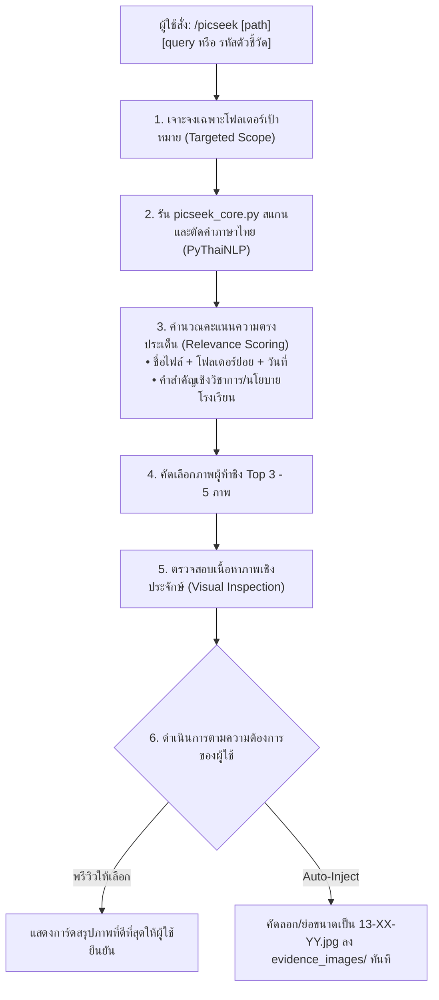

# สกิล PicSeek: Targeted Photo & Evidence Mining Engine
> คำสั่งลัด (Slash Command): **/picseek**  
> ปรัชญาการทำงาน: **"ชี้เป้าตรงจุด ไม่คุ้ยทั้งเครื่อง แม่นยำด้วยการตัดคำภาษาไทย และยืนยันความหมายเชิงประจักษ์"**

สกิลสำหรับค้นหา คัดกรอง และจัดหมวดหมู่ภาพถ่ายกิจกรรมโรงเรียน ภาพเอกสารหลักฐาน และภาพประกอบรายงาน โดยเจาะจงค้นหาเฉพาะโฟลเดอร์ที่ผู้ใช้ระบุ (เช่น Google Drive, โฟลเดอร์รูปกิจกรรมในเครื่อง, แฟลชไดรฟ์) เพื่อนำภาพที่ตรงกับ "ตัวชี้วัด / หัวข้อรายงาน" มาตั้งชื่อและใส่ลงในเอกสารโดยอัตโนมัติ

---

## 1. ผังกระบวนการทำงานหลัก (PicSeek Workflow)



---

## 2. วิธีการเรียกใช้งานคำสั่ง `/picseek`

### รูปแบบคำสั่งทั่วไป:
```text
/picseek "<path-to-folder>" "<คำค้นหาหรือคำบรรยายภาพ>"
```

### ตัวอย่างการใช้งาน:
1. **ค้นหาภาพกิจกรรมทั่วไป**:
   ```text
   /picseek "D:\MEGA\งานประกัน\แหล่งข้อมูล" "การแข่งขันหุ่นยนต์และพูลเจริญนิทรรศน์"
   ```
2. **ค้นหาภาพเจาะจงตัวชี้วัดรายงานประกัน (10ค)**:
   ```text
   /picseek "G:\My Drive\ภาพถ่ายกิจกรรม2569" "13-01 ภาพการอบรมครูดิจิทัล Chromebook Unleash"
   ```
3. **ค้นหาพร้อมคัดลอกลงช่องรายงานทันที (Auto-Fulfill)**:
   ```text
   /picseek "D:\รูปกิจกรรม" "ธนาคารโรงเรียน" --slot 13-11-07
   ```

---

## 3. สถาปัตยกรรมเอนจินแกนกลาง (Core Engine Script)

สคริปต์แกนกลางติดตั้งอยู่ที่:
`C:\Users\patti\.gemini\config\skills\picseek\scripts\picseek_core.py`

### ความสามารถของเอนจิน:
1. **Thai Morphological Tokenization**: ใช้ `pythainlp.tokenize.word_tokenize(engine='newmm')` ตัดคำภาษาไทยในชื่อไฟล์ โฟลเดอร์ และบริบทโดยรอบ ป้องกันปัญหาคำไทยติดกันเป็นพรืดแบบที่เสิร์ชเอนจินฝรั่งล้มเหลว
2. **Context Weighting**: ให้น้ำหนักคำสำคัญหลัก (Keywords), รหัสนโยบาย/ตัวชี้วัด, และข้อมูลเวลา (EXIF Date/Year 2568-2569)
3. **Format & Integrity Check**: ตรวจสอบความถูกต้องของไฟล์ภาพ (ป้องกันไฟล์รูปภาพชำรุด หรือ EXIF division-by-zero)
4. **Auto-Copy & Fit**: หากระบุ `--slot` สคริปต์จะคัดลอกภาพไปยังโฟลเดอร์เป้าหมาย พร้อมปรับสัดส่วนอัตโนมัติ (กว้าง 7.7 ซม. สำหรับแนวนอน หรือ สูง 4.5 ซม. สำหรับแนวตั้ง) ไม่ให้เอกสารล้นหน้า

---

## 4. มาตรฐานความปลอดภัยและประสิทธิภาพ (Invariants)
1. **No Full-Disk Scanning**: ห้ามสแกนทั้งไดรฟ์ C:\ หรือ D:\ โดยไม่มีเป้าหมาย ต้องค้นหาเฉพาะโฟลเดอร์ที่ผู้ใช้ระบุเท่านั้น
2. **Preserve Originals**: ห้ามย้ายหรือลบไฟล์ภาพต้นฉบับของผู้ใช้เด็ดขาด ให้ใช้การคัดลอก (Copy) เท่านั้น
3. **Zero Vibe-Coding**: คัดเลือกภาพโดยมีหลักฐานอ้างอิงชัดเจน (ระบุ Path, วันที่, และเหตุผลที่ตรงกับตัวชี้วัด)
