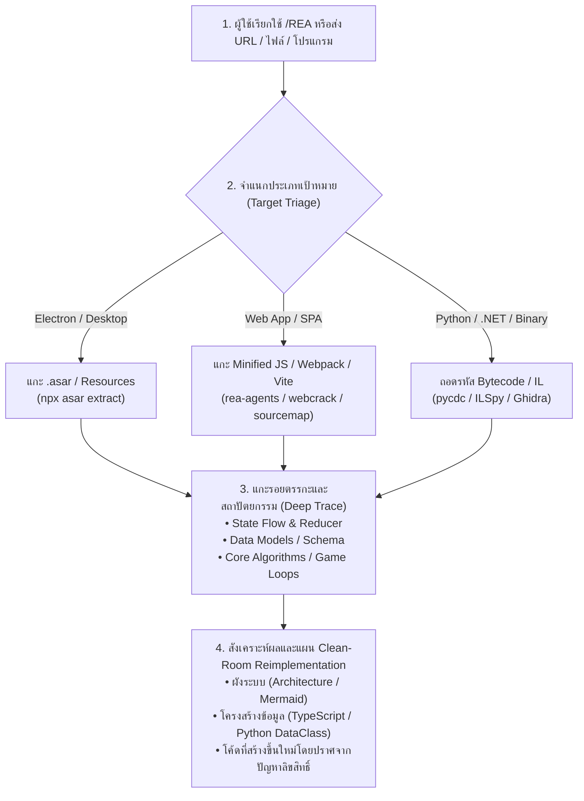

# สกิล REA: Reverse Engineer Anything
> คำสั่งลัด (Slash Command): **/REA** หรือ **/rea**  
> อ้างอิงตามสถาปัตยกรรมเครื่องมือ: [morluto/rea](https://github.com/morluto/rea)

สกิลสำหรับการถอดรหัส แกะโครงสร้าง ตรวจสอบสถาปัตยกรรม และวิเคราะห์ตรรกะการทำงานของแอปพลิเคชัน เว็บไซต์ ไฟล์บันเดิล และโปรแกรมภายนอก เพื่อนำอัลกอริทึมและโครงสร้างข้อมูลมาเขียนระบบใหม่ (Clean-room Implementation) สำหรับงานวิศวกรรมซอฟต์แวร์และสื่อการเรียนรู้

---

## 1. ผังกระบวนการทำงานหลัก (REA 4-Stage Execution Loop)



---

## 2. ขั้นตอนการปฏิบัติการเชิงเทคนิค (Technical Execution Steps)

### ขั้นที่ 1: การจำแนกและคลายไฟล์เป้าหมาย (Unpack & Deobfuscate)
ประเมินไฟล์ที่ผู้ใช้ต้องการแกะ และใช้เครื่องมือประจำระบบ:

1. **แอปพลิเคชันประเภท Electron / Desktop**:
   ```powershell
   # ติดตั้งหรือใช้ asar คลายแพ็กเกจ
   npx --yes asar extract "<path-to-app.asar>" "<output-directory>"
   ```
2. **เว็บแอปพลิเคชัน / JavaScript Bundle (Webpack, Vite, Rollup)**:
   ```powershell
   # ใช้ rea-agents วิเคราะห์โครงสร้าง
   npx -y rea-agents@latest analyze-javascript-application "<path-or-dir>" --json
   
   # หรือ De-minify / Unbundle ด้วย webcrack / prettier
   npx --yes webcrack "<bundle.js>" -o "<output-dir>"
   ```
3. **ไฟล์ Python Bytecode (`.pyc`)**:
   - ใช้ `pycdc` หรือไลบรารีวิเคราะห์ bytecode เพื่อกู้คืนตรรกะของฟังก์ชัน

---

### ขั้นที่ 2: การแกะรอยตรรกะเชิงลึก (Deep Logic Tracing)
เน้นการค้นหา "หัวใจของระบบ" โดยไม่หลงทางในไฟล์ UI ส่วนเกิน:
1. **State & Store Flow**: ตรวจสอบ State Management (Redux, Zustand, Pinia, Vuex, Context API) เพื่อดูว่าแอปเก็บตัวแปรสถานะอะไรบ้าง
2. **Data Taxonomy & Schema**: สกัดโครงสร้าง JSON / DTO / Database Entities เช่น โมเดลข้อมูลคำศัพท์ ระบบคะแนน ลำดับเทิร์น
3. **Core Engine / Algorithm**: แกะรหัสคำนวณ เช่น สูตรการสุ่ม (RNG), ระบบตรวจสอบเงื่อนไขความถูกต้อง, กลไก Game Loop
4. **Network & Storage Protocols**: ตรวจสอบ Endpoint API, WebSocket Events และ LocalStorage/IndexedDB

---

### ขั้นที่ 3: การรายงานหลักฐานเชิงประจักษ์ (Verifiable Evidence)
ทุกการวิเคราะห์ต้องมีหลักฐานชัดเจน:
- ระบุชื่อไฟล์และตำแหน่งบรรทัด (`file:///path/to/file#L10-L40`)
- นำเสนอชิ้นส่วนโค้ดสำคัญ (Code Snippet) ที่ถอดรหัสได้
- อธิบายลำดับการทำงาน (Sequence Flow) พร้อมคำอธิบายตรรกะเชิงลึก

---

### ขั้นที่ 4: การสร้างใหม่แบบ Clean-Room (Clean-Room Reimplementation)
- ⚠️ **กฎเหล็กด้านลิขสิทธิ์**: ห้ามคัดลอกโค้ดต้นฉบับมาแปะทับลงในโปรเจกต์โดยตรง
- ให้นำเฉพาะ **"แนวคิด (Concepts), โครงสร้างข้อมูล (Data Schemas) และขั้นตอนวิธี (Algorithms)"** มาเขียนขึ้นใหม่ด้วยภาษาและเฟรมเวิร์กของโปรเจกต์เรา (เช่น Vanilla CSS, modern JavaScript, Python-docx ฯลฯ) อย่างหมดจด

---

## 3. กฎเหล็กความปลอดภัยและจริยธรรม (Invariants)
1. **ห้ามยิง API หรือโจมตีระบบจริง (No Exploit / No API Flooding)**: ดำเนินการวิเคราะห์แบบ Isolated Local เสมอ
2. **Local Isolation First**: สกัดและอ่านไฟล์บนเครื่อง Local หากต้องการแกะเว็บให้ดาวน์โหลด Asset มาตรวจภายในเครื่อง
3. **Zero Hallucination**: หากโค้ดถูกเข้ารหัสซับซ้อน (Heavy Obfuscation / Native Packing) ให้รายงานตามจริง พร้อมเสนอแนวทางจำลองพฤติกรรมจาก I/O (Black-box Testing) แทนการคาดเดา
